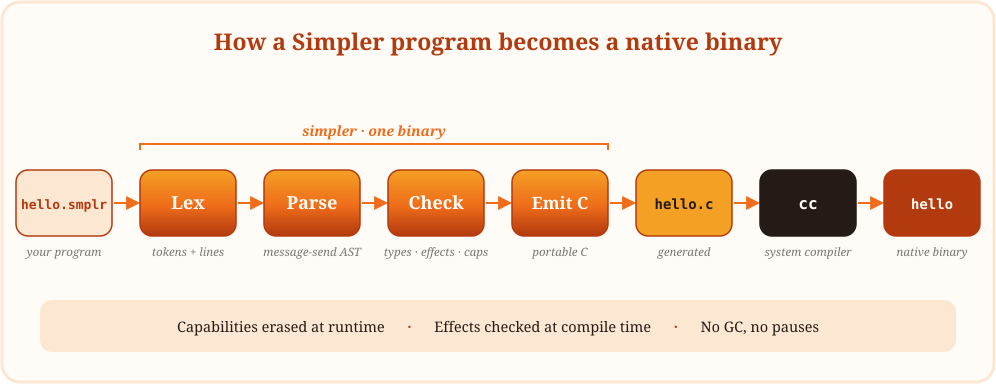

# Simpler


**The AI safe programming language.**

Let an AI write the program, then run it without reading it.


<br clear="left"/>

What keeps an unread program safe:

- **A locked room.** The top lines of a program name the files it may read and
  write, the programs it may run and the hosts it may reach. The kernel
  (Landlock) refuses everything else.
- **A look first.** `simpler what` lists all the program can touch.
  `simpler run --dry` prints what it would write, delete, start, fetch or mail,
  and does none of it.
- **An undo button.** `simpler undo` puts back every file the last run changed.
- **No silent mistakes.** An index past the end, a division by zero or a number
  too big for a whole number stops the program at its line. There are no
  pointers, no null and no threads.
- **Tests that always run.** The line `example double(4) == 8` above a function
  says that `double(4)` must give 8. `example "3 4", "7"` says the whole program,
  given the input `3 4`, must print `7`. Each build and run tries these lines first.
  If one gives a wrong answer, there is no program, only the line that failed.
- **A replay.** A run that fails keeps its input, and `simpler replay` runs it
  again for the AI that fixes it.
- **A leash.** `limits "2s", "50MB"` stops a program that spins or eats memory,
  and a loop that never waits is refused.
- **Safe from strangers.** `simpler run https://...` shows what a program can
  touch and asks once.
- **No prompts.** `simpler trusted` lets an AI tool run a program without asking,
  when its top lines fit the owner's rules file.

**Small enough to learn from one page.** A model has seen no Simpler code, so
the whole language must fit in its prompt. [PROMPT.md](PROMPT.md) is about 2,000
tokens; [SPEC.md](SPEC.md) is the full language. It compiles to C, so programs
are fast. The story of the safety parts: [A safety net for AI
code](https://isene.org/2026/11/Net.html).

## The idea

**Everything is a message send.** A field read, a method call, an operator: all
one thing, `receiver.name(arguments)`. There is one grammar
production, and that is the point. Four pieces of punctuation carry the syntax,
with zero overlap:

| Symbol | Means |
|--------|-------|
| `=` | bind a value to a name |
| `:` | ascribe a type |
| `{ }` | delimit a block |
| `.` | send a message |

The rest follows from a few committed decisions:

- **Effects live in the type, not the syntax.** Pure by default; anything that
  touches the world is marked (`!IO`, `!Fail`). A pure function cannot call an
  effectful one without saying so, so cost stays visible at every call site.
- **Capabilities replace imports.** There are no globals. `main` receives the
  world and passes subsets down, so a signature becomes a permission list: a
  function can only touch what it was handed.
- **Memory comes back, at no idle cost.** A small collector reuses memory a
  program no longer reaches and hands empty chunks back to the system. It runs
  only after 16 MB of new data, or just before the program waits, so a waiting
  program does no work. There is no borrow checker (nothing hard to learn).
  Capabilities are erased at compile time, so the permission system costs
  nothing at runtime.
- **Compiled via C.** The compiler transpiles to C and hands it to the system C
  compiler, which buys a mature optimizer and every platform for free.

The full reasoning, including why it is built to be written by an AI, is in
[the spec](SPEC.md) and [the book](Simpler.pdf).

## The goal

Five goalposts, each with a measure:

| Goal | Measure | November 2026 |
|------|---------|---------------|
| Nothing goes wrong silently | broken programs the compiler answers badly; run-time faults that stop with a line | 0 of 21,000; six fault types stop, whole-number overflow among them |
| Nothing is touched unseen | one command lists every file, program, host, screen and mail use of a program; a function that changes the caller's list or map must say `!Mut` | `./simpler what` does it; `!Mut` is checked; a program names the files it may read and write, the programs it may run and the hosts it may reach, and anything else is refused |
| As right as Rust on the first try | tools written by a model, compiled, run and compared: 20 small ones, 16 of 100 to 250 lines, and 10 of 200 to 900 lines that are then changed | small: 19 to 20 in Simpler, 20 in Rust; larger: 16 of 16 in Simpler, 15 to 16 in Rust; big, three runs: 22 of 30 on the first try in Simpler, 25 in Rust, 26 in Python, all 30 within three tries |
| No dearer than Rust | output tokens per working program | 1.8 to 2.1 times Rust, 1.7 times on the big programs; the code is 1.2 times, the rest is the model thinking |
| The whole language fits in a prompt | size of `PROMPT.md`, the page a model gets | about 2,000 tokens |

Speed and code a person likes to read are not goals.

## A taste

```
main(sys) {
  greet(sys.screen, "world")
}

// greet may ONLY use the screen it was handed, and must declare !IO.
greet(screen : Screen, who : Str) !IO {
  screen.print("hello,")
  screen.print(who)
}
```

`greet`'s signature is its whole world: it holds a `Screen` and a `Str`, it
declares the `!IO` effect, and it can reach nothing else. Drop the `!IO` and the
compiler refuses to build it. Reach for a capability you were not handed, and
the name is simply not in scope.

## How it compiles

<p align="center"></p>

The compiler is one small binary. It lexes your source into tokens, parses
them into a tree of message-sends, checks types, effects, and capabilities,
then emits portable C and hands it to the system C compiler. Effects and
capabilities are compile-time only, so they cost nothing at runtime.

## Try it

Install it (needs a C compiler and curl):

```bash
curl -fsSL https://raw.githubusercontent.com/isene/simpler/master/install.sh | sh
```

Or clone the repo and call `./simpler` there.

With Claude Code, add the skill, and Claude writes Simpler when asked ("write me a tool in Simpler that ..."):

```bash
mkdir -p ~/.claude/skills/simpler && curl -fsSL https://raw.githubusercontent.com/isene/simpler/master/skill/simpler/SKILL.md -o ~/.claude/skills/simpler/SKILL.md
```

Then:

```bash
simpler run hello.smplr        # compile and run
simpler what hello.smplr       # list everything the program can touch
simpler pieces hello.smplr     # list each function: what it takes, what it touches, its examples
simpler build hello.smplr      # make the program file ./hello
simpler test hello.smplr       # run its test_ functions
simpler prompt                 # the one page to give an AI that writes Simpler
simpler prompt regex json      # the page with parts added: regex json bytes net screen, or all
simpler prompt tui             # the page with a module added (tui, opts, astro)
```

**Modules.** `uses "tui"` at the top of a program brings in `tui.smplr`:
from next to the program, from `$SIMPLER_LIB`, or from the `lib` folder that
came with simpler. Its functions are called as `tui.show(...)`. A module is
plain Simpler with no `main`, so it can touch only what the program hands it,
and the program's top lines bind the module's code too.
[`lib/tui.smplr`](lib/tui.smplr) is the first one: panes for full-screen
terminal programs. A pane owns the terminal and has properties you set
(`p.title = "Files"`, `p.bg = "#232154"`); `tui.show(p)` draws it.
It is built on [`lib/screen.smplr`](lib/screen.smplr), the terminal as one
thing with a size and colours (`p.scr.bg`), which every pane has under it.
[`lib/opts.smplr`](lib/opts.smplr) is the second: options on the command line,
such as `-v`, `-o file` and `--out=file`.
[`lib/astro.smplr`](lib/astro.smplr) is the third, a full almanac: the sun, the
moon, the planets, Pluto, 105 bright stars and the 88 constellations. Where they
are, when they rise and set, how bright they are, moon phases to the minute,
eclipses of the sun and the moon (also as seen from one place), Jupiter's four
moons, Saturn's rings, twilight, seasons, oppositions and a list of all that
happens in a year. Its numbers are
checked against [PyEphem](https://rhodesmill.org/pyephem/), which shares no code
with it: places agree within 0.01 degrees, and all of 1,620 rise, transit and
set times within 1.1 minutes.

What goes on underneath:

**No Rust required.** The compiler is now written in Simpler. Its source is
transpiled to C and committed as [`selfhost/simpler.c`](selfhost/simpler.c), so a
plain C compiler bootstraps the whole language:

```bash
cd selfhost
./build.sh            # cc simpler.c -> ./simpler  (no Rust)
./build.sh --rebuild  # then ./simpler recompiles its own source and proves the fixpoint
```

To compile a program, the self-hosted compiler reads `input.smplr` and writes C
to stdout:

```bash
cp sample.smplr input.smplr && ./simpler > out.c && cc out.c -o out && ./out
```

It compiles real command-line tools, not just itself.
[`selfhost/linenum.smplr`](selfhost/linenum.smplr) reads the file named on the
command line, numbers its lines, and writes the result, the read-transform-write
shape most tools have:

```
reads args
writes args

main(sys) {
  args = sys.args
  if args.length < 2 {
    sys.screen.print("usage: linenum <in> <out>")
  } else {
    src = sys.files.read(args.at(0))?
    sys.files.write(args.at(1), number(src))
  }
}
```

`number` is a pure `Str -> Str` function, so only `main` ever touches the disk.
A function that called `.write` without declaring `!IO` would be rejected. The
command line arrives as `sys.args`, a plain `List[Str]`, so the same list
methods (`.length`, `.at`, `.each`) work on it. A numeric argument becomes an
`Int` with `.toInt` (the inverse of `.toStr`), so a tool can do arithmetic on
what it is given. `"a,b,c".split(",")` returns a `List[Str]`, so a line of text
splits into fields that compose straight into `.each` and `.toInt`.
`s.contains("x")` is a `Bool` test and `s.replace("x", "y")` rewrites every
occurrence, the two string edits most text tools reach for.

[`selfhost/sumcol.smplr`](selfhost/sumcol.smplr) puts it together: a CSV
column-summer (`sumcol <file> <col>`) that reads a file, splits it into lines,
splits each line on commas, and sums one column, the read-split-fold shape of a
real reporting tool, in the language's own primitives. Both tools report a usage
error with `fail("...")`, which writes the message to stderr and exits nonzero,
so they behave in a shell pipeline the way a real command does.

For counting and grouping there is a `Str`-keyed `Map`. `Map()` makes an empty
one; `m.set(k, v)`, `m.get(k)`, and `m.has(k)` store, read, and test it, and
`m.keys` enumerates the keys in first-seen order, and `m.byValue` enumerates
them ranked by descending value (a stable sort, so ties keep first-seen order),
which is how you turn a tally into a ranking. Values are `Int` by default;
annotate the binding (`dir : Map[Str] = Map()`) for a `Str`-valued map, and
`get` returns that type, so string methods dispatch on the result. `m.get`
returns a default for a key that was never set, `0` for an `Int` map and the
empty string for a `Str` map (never a null pointer), so a tally increments
without a guard:

```
counts = Map()
words.each { w in counts.set(w, counts.get(w) + 1) }
counts.keys.each { k in sys.screen.print(k.concat(": ").concat(counts.get(k).toStr)) }
```

[`selfhost/wordfreq.smplr`](selfhost/wordfreq.smplr) is exactly that: a
word-frequency counter built from read, `replace`, `split`, the `Map`, and
`.byValue`, so it prints the most frequent words first. It is a real Unix
filter, reading a named file or, with no argument,
standard input through `sys.stdin` (the whole of stdin as a `Str`), so both of
these print the same tally:

```bash
wordfreq prose.txt
cat prose.txt | wordfreq
```

A list sorts with `xs.sort`, which returns a new list ordered by its element
type: numerically for `List[Int]`, lexically for `List[Str]`.
[`selfhost/sortlines.smplr`](selfhost/sortlines.smplr) is the Unix `sort` in
miniature on top of it. An empty collection takes its element type from its
annotation, so `xs : List[Str] = []` really is a list of strings once you fill
and walk it.

For fractions there is a `Float`: a literal like `2.0`, the four arithmetic
operators, and ordering. `n.toFloat` and `x.toInt` convert (the latter
truncates), `"3.14".toFloat` parses, and `f.toStr` formats. `Int` and `Float`
never mix silently: `3.5 + 2` is a compile error until you convert one side.
[`selfhost/average.smplr`](selfhost/average.smplr) is the tool that needs them,
the mean of the numbers on its input:

```bash
printf '1.5\n2.5\n3\n4.0\n' | average    # 2.75
```

The original Rust bootstrap is retired. It is in the git history up to
commit a3834a2; its checks and its `test` runner now live in the self-hosted
compiler. `./simpler test` runs the `test_*` functions of `input.smplr`.
There is no formatter.

## Development

The compiler has its own regression harness: golden output for every example,
expected error messages for known-bad programs, and the `test` runner. One
command, green or red:

```bash
./run-tests.sh
```

`SAN` builds the compiler and every test program with a C checker, and a fault
the checker finds fails the test:

```bash
SAN=-fsanitize=undefined ./run-tests.sh   # undefined behaviour in the C
SAN=-fsanitize=address ./run-tests.sh     # a read or write outside memory it owns
```

## Status

**Self-hosting and Rust-free.** It grew one runnable milestone at a time, from the
first lexer to a compiler that compiles itself:

- [x] **M1** the spine: lex, parse, emit C, compile end to end
- [x] **M2** integers, the seven operators, locals, `if`/`else`, `n.times`, typed `print`
- [x] **M3** effects (`!IO`/`!Fail`), capabilities, user functions, all checked
- [x] **M3b** `?` failure propagation, the `Files`/`Mail` capabilities, named arguments
- [x] **M3c** value-returning user functions and cross-function `?`
- [x] **M4a** the canonical `fmt` formatter (comment-preserving, idempotent)
- [x] **M4b** the `test` runner with the `assert` built-in
- [x] **M5a** user-defined record types (`type { fields }`, value-semantic C structs)
- [x] **M5b** variants and exhaustive `match` (tagged unions)
- [x] **M5c.1** built-in value methods (`Str`/`Int`/`Bool` ops, `Bool` literals, `Str` equality)
- [x] **M5c.2** recursive variants via heap-boxing, multi-payload cases (a type can hold itself)
- [x] **M5c.3** `match` as a value (recursive evaluators: `Add(a, b) -> eval(a) + eval(b)`)
- [x] **M5c.4** lists (`[…]`, `push`, `length`, `at`, `each`; elements of any type)
- [x] **M6** `while`, a general loop (the one control-flow shape a scanner needs)
- [x] **Self-host** ✅ **the compiler is written in Simpler and compiles itself.**
  [`selfhost/simpler.smplr`](selfhost/simpler.smplr) runs the whole pipeline, lex to
  parse to C, and reaches the three-stage byte-identical fixpoint: the bootstrap
  builds it, it compiles its own source, and that output compiles its own source
  to a byte-for-byte identical result. The harness checks this on every run. It
  was grown one runnable step at a time, each verified against the bootstrap:
  - [x] **lexer** the full Simpler token set: identifiers, ints, strings with escapes, comments, every operator including `->` and `==`
  - [x] **variant types and `match`** payload-less cases as a C enum; payload-bearing cases boxed in a uniform `{tag, slots}` object, so recursive and multi-field cases (`Add(Expr, Expr)`) just work; match bindings read each payload back by position
  - [x] **functions, calls, locals, arithmetic, `print`** an AST out as C that builds and runs; it already compiles a recursive tree evaluator
  - [x] **`if`/`else`, `while`, comparisons** with reassignment (locals hoisted so a binding can be reused)
  - [x] **record types and field access** real C structs, resolved through a local type environment (variable to type), the front half of the checker
  - [x] **typed params/returns and `Str` methods** string literals, `.concat`/`.length`/`.at`/`.code`/`.slice`/`.toStr`, string `==`, and `print` choosing `%s` or `%ld`, all dispatched on inferred types
  - [x] **`List` methods** list literals, `.push`/`.at`/`.length` (disambiguated from `Str` by receiver type), and `.each { x in ... }` lowered to a counted C loop, over a growable-list runtime
  - [x] **typed record fields** each field's declared type is stored and resolved, so a `Str` field picks `s_eq` and a `List` field picks `l_len`, the way the compiler reads its own AST
  - [x] **capabilities** `main(sys)` becomes C `int main()`, and `sys.screen.print(x)` lowers like the built-in print (the erased capability path drops out, only the print remains)
  - [x] **string re-escaping** literals are re-escaped on emit (`\n`, `\"`, `\\`, `\t`, `\r`), so a string with a newline survives the round trip into valid C
  - [x] **reading its own source** (`sys.files.read`, `?`), typed match bindings, and nested-binding type inference, the last gaps the fixpoint exposed
  - [x] **the three-stage byte-identical fixpoint** ✅ stage2 and stage3 match to the byte
- [x] **Beyond the bootstrap** the self-hosted compiler is now a superset of the
  Rust on what it rejects: it catches every type-, structure-, and effect-level
  error the Rust does, with source locations, and still compiles itself to the
  byte-stable fixpoint. (Adding a check means the compiler now needs to *report*
  errors, so its source uses a `fail` primitive the frozen Rust does not have;
  from here it is built only from its own C seed.) A name that was never
  given is now a Simpler error too.
  - [x] **error reporting** a `fail` primitive: a compile error prints to stderr and stops the compiler
  - [x] **`match` exhaustiveness** every case of the matched variant must have an arm, else a compile error
  - [x] **operand types** arithmetic and ordering (`+ - * / < >`) require Int operands; `1 + "a"` is rejected
  - [x] **argument types** a call checks each argument against the parameter's declared type; `greet(5)` where `greet` wants a `Str` is rejected
  - [x] **record field types** a constructor checks each field value against its declared type; `Point(x = 1, y = "a")` is rejected
  - [x] **return types** a function's value must match its declared return type; `twice(n) : Int { "no" }` is rejected (`match`-bodied functions are skipped, their type is not inferred)
  - [x] **match arity** each arm binds exactly as many payloads as its case carries; `Add(a)` where `Add` has two is rejected
  - [x] **source locations** every error reports `input.smplr:<line>:`, the line of the statement (the lexer tracks a line per token, and each statement carries its line). The parser refuses what it does not expect and says what it found; 6,000 slightly broken programs gave no crash and no C that fails to build
  - [x] **effects** `!IO`/`!Fail` coverage: a function must declare every effect it uses, directly through a capability call (`.print`/`.read`/`.send`) or transitively by calling an effectful function; `main` is exempt. Capabilities are typed (`sys.screen` is a `Screen`, erased to `0` at runtime) so they pass to capability parameters. The one piece left to the C compiler: using a capability that was never handed in is caught as an undefined name, not yet as a Simpler-level error.
  - [x] **`reads` and `writes`**: a program names at the top the files and folders it may touch. A file call outside them is refused by the compiler when the path is written out, and stops the program when the path is made while running. `./simpler what` prints the two lists.
  - [x] **`runs` and `fetches`**: the same rule for other programs (`sys.programs.run`, started without a shell) and for web hosts (`sys.net.fetch`, `sys.net.post`). `sys.clock` and `sys.env` read the time and environment variables.
  - [x] **Full-screen terminal programs**: `sys.term` puts text at a place, waits for one key at a time and gives the terminal back when the program ends, also after an error. `simpler what` says when a program takes the terminal.
  - [x] **`mails`**: a program names at the top whom it may send mail to (`mails "me@example.com"`, or `"*@example.com"` for everyone there; a `*` works the same way in `reads`, `writes` and `fetches`); any other address is refused, at compile time when written out and when the mail is sent otherwise.
  - [x] **The kernel lock**: on Linux a built program hands its top lines to the kernel (Landlock) before it starts. The kernel then refuses every other file, for the program and for each program it runs, so `runs "sh"` no longer opens the whole machine. With no `fetches` line nothing in the tree reaches the net, and nothing in it can become root. It costs about 20 system calls at the start. Mail goes through a small helper outside the lock, which checks the address again.
  - [x] **Examples at the top**: `example "3 4", "7"` gives an input and the output wanted (then any arguments). A build runs each one and gives no program when one differs, so a program that runs has passed its examples.
  - [x] **Pieces**: `example double(4) == 8` above a function is a check on that one function, run at every build. `simpler pieces` lists each function with what it takes, what it touches (also through the functions it calls) and how many examples it has.
  - [x] **Limits**: `limits "2s", "50MB"` at the top caps processor time and memory, for the program and each program it starts. A program that spins or eats memory stops with a line that says why, so it cannot drain the battery.
  - [x] **Undo**: `simpler undo prog.smplr` puts back every file the program's last run wrote, appended to, renamed or deleted, and removes the files it made. The old copy is taken the first time a run touches a file (files up to 16 MB).
  - [x] **Replay**: a run that ends with an error keeps its arguments and input. `simpler replay prog.smplr` runs it again, and `simpler replay --show prog.smplr` prints them for the AI that fixes the program.
  - [x] **Memory comes back**: a program that runs for days stays small. Memory it no longer reaches is reused, and empty chunks go back to the system just before it waits, so an idle program holds a few MB and does no work. Text is never scanned for pointers. The compiler itself runs in 64 MB instead of 316 MB, and no slower.
  - [x] **No idle drain**: a `while true` loop that neither waits nor ends is refused by the compiler, and `limits` stops a program that spins anyway.
  - [x] **A tiny web server**: `listens 8080` at the top lets a program answer web requests on that port, from this machine only. `sys.net.request` sleeps until a request comes and gives its fields decoded; `sys.net.reply` answers it.
  - [x] **A terminal of its own**: `sys.programs.drive` starts a program on a terminal of its own. `press` types into it, `shown` gives what it printed, and `end` stops it with every program it started.
  - [x] **Safe from strangers**: `simpler run https://...` fetches a program, shows everything it can touch and asks once at the terminal. The kernel holds it to what was shown.
  - [x] **A dry run**: `simpler run --dry prog.smplr` prints what the program would write, delete, start, fetch or mail, and does none of it. The kernel backs it: a dry run gets no `writes` names and no net.
  - [x] **Run without a question**: `simpler trusted prog.smplr [args]` succeeds when every name on the program's top lines is inside the rules file `~/.config/simpler/trust` (the same `reads`, `writes`, `runs`, `fetches` and `mails` lines, written by the owner of the machine; `runs "*"` is any program). An AI tool's permission hook can then let `simpler run` through without asking, since the kernel keeps the program to those lines. With no rules file the answer is always no.
  - [x] **Overflow stops**: whole-number `+`, `-`, `*`, a minus sign, `abs`, a division by -1 and `toInt` stop the program at its line when the answer does not fit, where C would wrap round to a wrong number. The check costs no time we could measure: the compiler builds itself in 0.65 s with it and without it.
  - [x] **Links**: a link inside an allowed folder that leads out of it is not followed.
  - [x] **`break`, `continue`, `xs.set(i, x)`, `xs.remove(i)`** and the forms models write from habit (`!=`, `!x`, `+` on texts, `for x in xs`).
  - [x] **`!Mut`**: a function that changes a list or map it was handed (directly, through another name for it, through a part of it, or by passing it to a `!Mut` function that changes it) must declare `!Mut`; `main` is exempt.
- [x] **A language for real programs** past self-hosting, the pieces an everyday
  command-line tool needs, each grown with a working example and a regression
  test:
  - [x] **I/O**: `sys.files.read`/`write`/`append`/`list`/`exists`/`rename`/`delete`, `sys.args`, `sys.stdin`, and
    `fail` to stderr with a non-zero exit, so a program is a real Unix filter
  - [x] **text**: `split`, `contains`, `replace`, `trim`, `padLeft`/`padRight`,
    `toInt`/`toFloat`/`toStr` on top of `concat`/`slice`/`at`/`length`; `Int.mod`
  - [x] **data**: a `Str`-keyed `Map` (`Int` or `Str` values, `keys`/`byValue`
    ranking) and list `sort`, plus 64-bit `Int` and `Float` with negatives
  - [x] **math**: `Float` `sin`/`cos`/`tan`/`asin`/`acos`/`atan`/`sqrt`/`floor`/`ceil`/`round`/`abs`/`ln`/`exp`,
    `atan2`, `pow` and `%`, wrapping libm (math programs link `-lm`; the compiler does not)
  - [x] **composition**: uniform function call, `x.f` is `f(x)`, so a chain of
    your own words (`data.parse.normalize.render`) is the nested call form and
    packages into a single word; functions and methods are one kind of brick
  - [x] **shipped tools** in [`selfhost/`](selfhost/): `linenum`, `sumcol`,
    `wordfreq`, `sortlines`, `average`, `numstats`, `slug`, and `orbit` (an
    ephemeris: sun rise/set, moon phase), each built by the self-hosted compiler
    and checked end to end
  - [x] **the corpus holds up**: `numstats` and `slug` were each written by an AI
    from [SPEC.md](SPEC.md) alone, with no sight of the compiler or the other
    examples, then compiled and run unchanged, a round-trip test that the spec is
    a sufficient corpus to write Simpler. `slug` is the composition showcase:
    small `Str -> Str` words snapped into one (`s.trim.noCommas.noPeriods.
    hyphenated`) and applied as `line.slug`
  - [x] **`orbit`**, the ephemeris from the [Fe2O3](https://isene.org/fe2o3/)
    suite, ported to Simpler by an AI and matching the Rust original's test
    values. Porting it surfaced and drove two robustness fixes: a method call's
    `(` must sit on the same line as its name (so `expr.field` on one line and
    `(...)` on the next are two statements, not a bogus method call), and user
    function names are mangled so they never clash with a C library symbol

See it for yourself, the fixpoint with no Rust at all:

```bash
cd selfhost
cc -O2 simpler.c -o simpler   # build the compiler from its committed C seed
cp simpler.smplr input.smplr
./simpler > stage2.c          # the Simpler compiler compiles its own source
cc stage2.c -o stage2
./stage2 > stage3.c           # and that compiler compiles it again
diff simpler.c stage2.c       # identical: the fixpoint
```

The first brick, [`selfhost/calc.smplr`](selfhost/calc.smplr), is still here too:
a tiny lex-parse-fold pipeline that reads an expression and emits C, the idea in
miniature.

## Read more

- **[PROMPT.md](PROMPT.md)** the language on one page, the text a model gets before it writes
- **[SPEC.md](SPEC.md)** the entire language in one file, the full reference
- **[PLAN.md](PLAN.md)** how it gets built, milestone by milestone
- **[DESIGN.md](DESIGN.md)** the visual and verbal language
- **[Simpler.pdf](Simpler.pdf)** all of the above as a short book

## License

[Unlicense](LICENSE), public domain. By Geir Isene.
